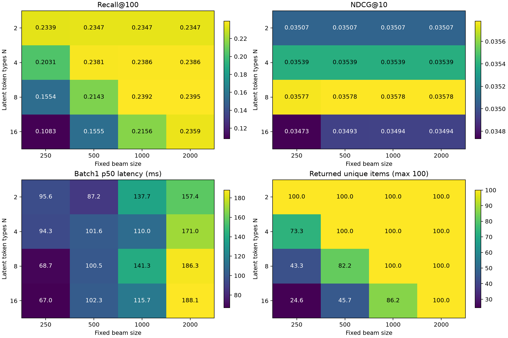
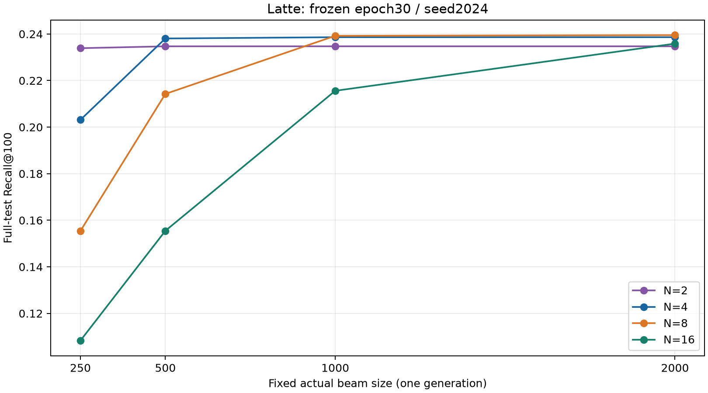
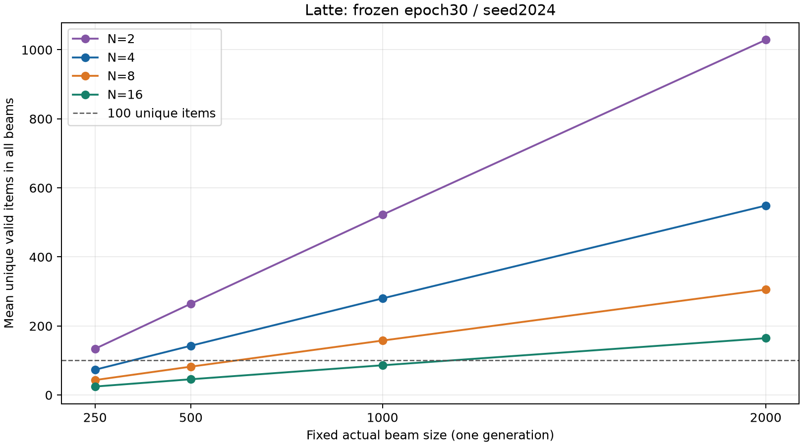

# Latte：生成式推荐复现与搜索预算消融

基于官方 [Latte](https://github.com/hyp1231/Latte)，在 Amazon Reviews 2023 / Video_Games 的 **94,762 名测试用户、25,612 件商品**上完成 **5 组 Latent Token 消融**与 **16 组 Latent × Beam 联合实验**，分析召回质量、候选覆盖与推理成本。

[实验报告](docs/REPORT.md) · [完整结果](data/joint16/results.csv) · [方法说明](docs/METHODOLOGY.md) · [复现说明](docs/REPRODUCIBILITY.md)

## 核心工作与结论

- **联合消融**：固定训练预算（30 epoch / 62,160 updates，seed=2024），评估 N=2/4/8/16 × Beam=250/500/1000/2000；每条输出仍只有一个 latent token，联合实验关闭自动 Beam 重试。
- **预算决定配置选择**：Beam=250、500、1000/2000 时，Recall@100 最高的 N 分别为 2、4、8（仅限本轮四份冻结权重）。
- **定位候选覆盖瓶颈**：N=16、Beam=1000 时，有效路径中约 **91.36%** 对应重复商品，平均仅返回 **86.17** 个唯一商品；Beam 增至 2000 后，平均返回数达 **99.98**，与同 Beam 的 N=8 的召回差距缩小约 **84.6%**。
- **量化边际收益与不确定性**：N=8 的 Beam 从 1000 增至 2000，仅净增 **28 个命中**，Recall@100 增加 **0.0295 个百分点**；提供用户配对 Bootstrap、候选审计与错误注入测试。



### 召回随 Beam 的变化



N=2/4 较早趋于平稳，N=16 在当前范围内仍受益于更大的搜索预算；有限四档预算不用于外推普适饱和点。

### 唯一候选覆盖



不同 latent 路径可能生成同一商品，去重后候选数量低于 Beam；更大的 N 需要结合搜索预算评估覆盖率。

## 代表性结果

| N / Beam | Recall@100 | P50 / P95（ms） | 峰值 allocated（MiB） | 满 100 候选用户比例 |
|---|---:|---:|---:|---:|
| 2 / 500 | 0.234704 | 87.23 / 96.52 | 534.1 | 100.000% |
| **4 / 1000** | **0.238619** | **109.95 / 143.83** | **1005.7** | **99.998%** |
| 8 / 2000 | 0.239505 | 186.31 / 227.75 | 1964.9 | 99.951% |

N 为 latent token 种类数。延迟来自 RTX 4090 **共享 GPU 观测**，显存为本进程 PyTorch 峰值 allocated，不代表隔离性能或线上 SLA。点估计最高不等于可靠更优：Beam=1000 下 N=8 相对 N=4 的召回差异，其配对 Bootstrap 95% 区间包含 0；36 项比较为探索性分析，未作整体多重比较校正。

## CPU 快速复核

建议 Python 3.10–3.12；无需 GPU、权重或原始交互数据。

```bash
python -m pip install -r requirements.txt
python scripts/verify_results.py
python -m unittest discover -s tests -v
python scripts/plot_results.py
```

重绘图表输出至 `outputs/figures/`。汇总与匿名排名数据位于 [`data/`](data/)，核验与绘图代码位于 [`scripts/`](scripts/)，历史训练/推理实现位于 [`reference/`](reference/README.md)。

## 复现边界与许可

本项目是**固定预算、单训练种子**的官方模型复现与实验分析，不声称提出 Latte、达到 SOTA 或验证 Scaling Law。上游固定 commit 为 `05e4e6d983225bcb7172f148a076890e80c524d1`；仓库不分发权重或原始交互数据，完整 GPU 训练需按[复现说明](docs/REPRODUCIBILITY.md)准备外部资产与运行环境。

实验辅助与分析代码采用 [MIT License](LICENSE)；上游模型、数据与依赖遵循各自许可，见[第三方说明](NOTICE.md)。
