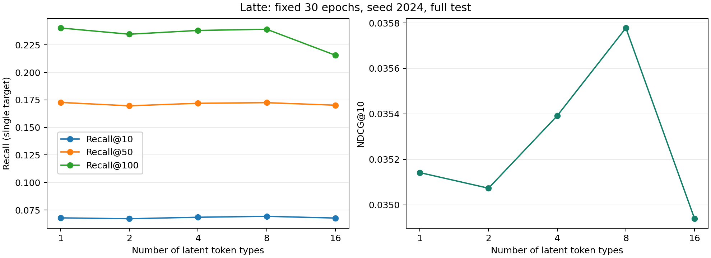

# 已完成实验与口径演变

三轮实验使用同一数据与固定 epoch30 / step62160 权重。它们的解码和计时条件不同，独立保存；不能把不同轮次的延迟拼成统一排名。

## 第一阶段：五组 Latent Token 消融

完成日期：2026-11-23。N=1/2/4/8/16，每组固定 30 epoch、seed2024，全部 94,762 名测试用户。

解码采用官方初始 Beam500，不足 100 个不同商品时最多再执行一次完整 Beam1000 生成。以下质量指标与该重试协议绑定；成本是历史独占计算进程检查下的测量，节点未锁 GPU 时钟。

| N | Recall@10 | Recall@50 | Recall@100 | NDCG@10 | batch1 P50 ms |
|---:|---:|---:|---:|---:|---:|
| 1 | 0.067823 | 0.172738 | **0.240360** | 0.035142 | 75.11 |
| 2 | 0.067063 | 0.169646 | 0.234704 | 0.035073 | 73.25 |
| 4 | 0.068413 | 0.171968 | 0.238133 | 0.035392 | 71.51 |
| 8 | **0.069237** | 0.172516 | 0.239210 | **0.035778** | 174.07 |
| 16 | 0.067675 | 0.170205 | 0.215603 | 0.034939 | 163.61 |

第一阶段的重要发现是：NDCG 不随 N 单调上升；N1 的 R@100 最高、N8 的 R@10/NDCG 最高；N4 的历史 batch1 P50 最低。但初始 Beam 相同不代表实际搜索工作量相同：N8、N16 的计时请求都触发了完整 B1000 重试，而 N4 只有少量请求触发。

因此，“N4 比 N8 快多少”在第一阶段还混合了重试成本，不能直接解释为 latent 种类本身的计算效应。后续固定 Beam 验证由此展开。

原始表保留 batch1 和 batch4 共 10 行；同一 N 的质量指标重复列出，分别绑定两个性能测量 batch。见 [`data/phase1/results.csv`](../data/phase1/results.csv)。

## 第二阶段初始验证：九组固定实际 Beam

完成日期：2026-11-23。N=4/8/16 × B=500/1000/2000，共 9 组，每组完整测试用户；不训练、不新增训练种子，关闭自动扩大 Beam。

发现 N16 扩大 Beam 后明显改善候选覆盖，N8 的 B1000→2000 召回收益很小。历史成本在另外的独占计算进程检查批次测量；不能与后续共享卡批次直接混算延迟差或 Pareto。

[`data/phase2/results.csv`](../data/phase2/results.csv)保留这 9 组历史数值。公开核验器检查其四项质量指标与最终 16 组中对应的复用点完全一致，**不要求不同批次的成本一致**。

## 第二阶段扩展：十六组联合消融

完成日期：2026-11-24。增加 N=2 的四档 Beam，以及 N=4/8/16 的 B250，补 7 组质量；复用上轮 9 组可比质量，全部 16 组成本在本轮同一物理 RTX4090 重新测量。

共享服务器全部 GPU 均有其他计算进程，按可用资源执行并记录背景占用。本轮成本统一标为共享观测，原独占准入限制被明确的资源/成本补充协议替代；没有把它伪装为独占基准。原始科学协议与源码在完整私有审计包中保留，公开配置给出最终实际口径。

此轮完成 4 组关键配置的三遍完整候选重放、36 项配对 Bootstrap 与全量候选审计，给出覆盖约束下的条件预算建议。详见[最终报告](REPORT.md)和首页四张联合实验图。

## 当前范围

已完成的是官方模型复现、固定预算的 latent 消融和 latent × beam 搜索预算分析。尚未开展 Data Scaling、复杂曲线拟合或 Scaling Law 验证；本轮也未新增训练种子。
